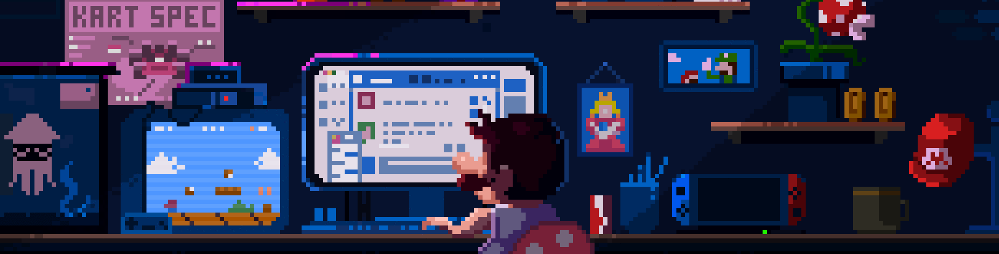

  

<h1 align="center">Hi, I'm Victor Moni 👋</h1>

<h3 align="center">Full Stack Developer · .NET & Java · Angular & React</h3>

  

  

  

## 🌟 About Me

I'm a Full Stack Developer with experience in enterprise systems and RESTful APIs,
working with C#, .NET, Java, Angular, React, TypeScript, and SQL.

- 🎓 Postgraduate specialization in Cloud Computing.
- 🔐 Currently studying Information Security.
- 🧩 Focused on readable code, software quality, and maintainable architecture.
- 🌱 Deepening my knowledge of cloud-native applications and DevSecOps.
- 🤝 Interested in collaboration, knowledge sharing, and open-source contributions.

## 🎯 Current focus

- Building and documenting portfolio projects.
- Exploring microservices and cloud-native architectures.
- Strengthening application security practices.
- Contributing to open source and sharing what I learn.

## 💻 Tech Stack

  

## 📢 Feature Projects

  
  &nbsp;
  
  &nbsp;
  

## 🛡️ Holopin Badges

Apache Doris Community Badge

## 💡Daily.dev Card

  

## 📊 GitHub Overview

  
  

## 🏆 GitHub Trophies

  <picture style="min-width: 90%; display: block;">
    <source media="(max-width: 600px)"
            srcset="https://trophy.ryglcloud.net/?username=VictorMoni&theme=onedark&row=2&column=4"/>
    
  </picture>

## 📱 Connect With Me

 

## ✍️ Dev Quote

  <picture>
    <source
      media="(max-width: 600px)"
      srcset="https://quotes-github-readme.vercel.app/api?type=vertical&theme=dark&heigth=400"
    />
    
  </picture>

## ☕ Support My Work

  

  <b>Crafted with ❤️ by Victor Moni</b> 
  Let’s build something incredible together.

